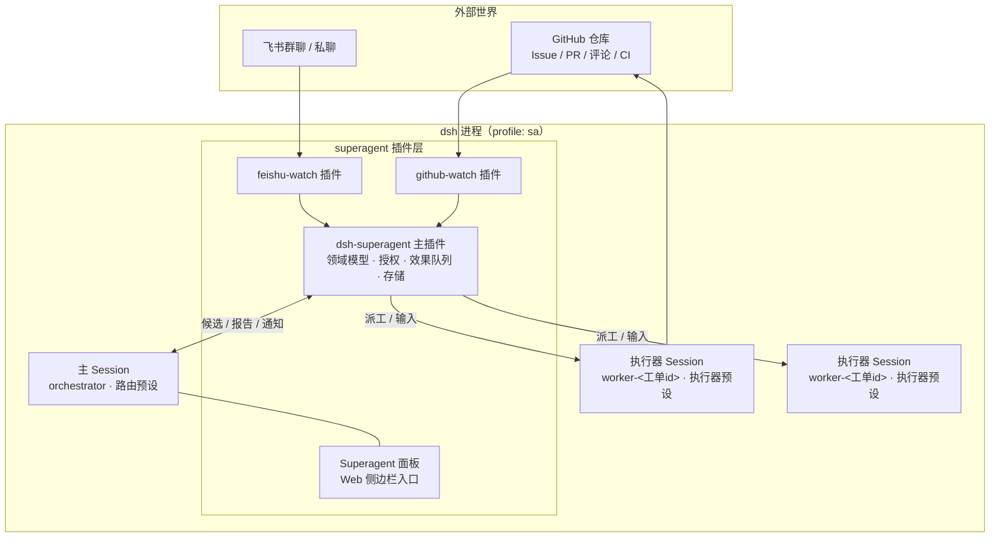
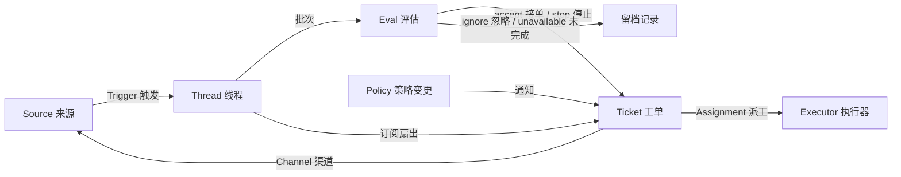
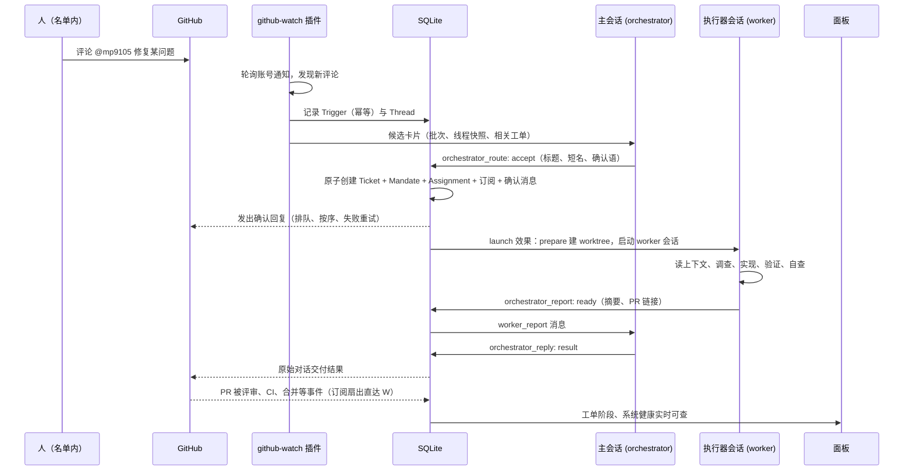

# DSH Superagent 技术调研：定位、机制与架构

> 本文档调研 dsh 的 superagent：它是什么、如何运作、设计质量如何。全文回答三个问题：第一章给出定义，并把 superagent 与 DSH 本身、普通编码智能体、CI 机器人等相邻概念区分开；第二、三章拆解它的运行机制与代码架构，覆盖领域模型、授权、执行、提示词、面板与部署；第四章到第七章给出评价：设计哲学、优势、限制与未决问题，以及它与 DSH 的依赖关系和未来方向。

调研以一手来源为准：dsh-superagent 原型仓库（本地检出，上游为 [github.com/deepseek-ai/dsh-superagent-prototype](https://github.com/deepseek-ai/dsh-superagent-prototype)，提交 `6337fc8`，2026-10-31），随 DSH `0.2.1-rc.5` 安装的插件包（`@deepseek-ai/dsh`），以及本机一次真实部署（profile `sa`，状态目录 `~/.dsh/state/sa`，面板端口 3081）。外部媒体报道只在背景处引用，机制描述一律以代码与文档为准。

## 一、什么是 dsh 的 superagent

### 1.1 定义

dsh 的 superagent（项目名 dsh-superagent）是一个围绕单个 GitHub 仓库持续运行的主动式编码智能体，以 [DeepSeek Harness](https://www.deepseek.com/en/harness/)（下称 dsh）插件 bundle 的形式交付。它监听 GitHub，可选监听飞书；当获得授权的人向它提出工作请求时，它开立一张工单（Ticket），在自己的智能体会话和独立目录中完成这项工作，然后在原始对话中交付结果，例如一个 Pull Request。一个 Web 面板展示哪些事项需要人工处理。

**一个合格的 superagent 必须具备：**

1. **事件入口**：从至少一个外部消息源（GitHub、飞书）持续接收事件，重启之后按记忆的位置继续读取，不重复处理。
2. **授权层**：只有名单内的人直接提出的请求才能成为正式工作；其余消息要么被忽略，要么先被记录为"观察"，由书面规则决定是否可以自动接单。
3. **工作单元**：每个被接受的请求产生独立的工作单元，拥有自己的执行会话、工作目录、分支与 Pull Request 生命周期。
4. **角色分离**：一个主会话负责评估与派工，不碰实现细节；执行会话负责调查、编码与验证，不接触派工决策。
5. **受控的表达**：只在有人必须行动或可以使用结果时发言，默认安静；每条发出的消息都注明自动化身份。
6. **可监督**：面板只展示需要人的事项，健康状态不占空间，一切状态可追溯到原始事件。

### 1.2 它在 DSH 里的位置

dsh 是交互式编码 harness：它以 profile 为单位运行，提供智能体会话（Session）、工具（文件、命令、子代理、技能等）、模型接入与 Web 界面。superagent 在 dsh 之上增加了一层常驻的"任务系统"：把外部消息转成授权的工作单元，再把工作单元分派给 dsh 智能体会话执行。本机部署中，两者甚至共用同一个 profile（`sa`）与同一个 Web 端口（3081）：superagent 的主会话、执行器会话、面板都是 dsh 进程里的普通参与者。

### 1.3 与相邻概念的区别

| 维度 | **dsh superagent** | **dsh 本身** | **单次编码智能体任务** | **CI 机器人** |
| --- | --- | --- | --- | --- |
| 运行时长 | 常驻进程，随事件驱动 | 随用户使用，用完即停 | 一次提示词调用或一轮对话 | 常驻，但只在代码推送后触发 |
| 请求来源 | 人直接点名（GitHub @、飞书 @），或书面规则允许的主动候选 | 坐在终端前的人 | 人 | 代码变更 |
| 授权模型 | 名单 + 准入表 + 授权书（Mandate）+ 可版本化的策略 | 操作者本人即授权 | 操作者本人即授权 | 仓库写入权限 |
| 工作单元 | 工单：独立目录、分支、会话、Pull Request 生命周期 | 会话 | 会话或子任务 | 流水线的一次运行 |
| 与人的交互 | 默认沉默；只在结果就绪、需要决定或无法完成时发言 | 全程交互 | 全程交互 | 基本不交互 |
| 交付物 | 原始对话中的回复 + Pull Request | 终端里的回答与文件改动 | 同左 | 构建结果、检查评论 |

辨析三条：

- **与 dsh 的关系**：superagent 完全构建在 dsh 提供的能力之上（Session、预设、工具、插件机制、Web 界面），自己没有模型接入、没有工具运行时。它贡献的是一层领域逻辑：事件、授权、工单、派工与监督界面。
- **与单次编码任务的区别**：单次任务的生命周期是一次对话；superagent 的关键设计都在对话之外——事件的读取位置、策略的版本、工单的恢复、报告的持久化。重启进程后一切状态可从 SQLite 恢复，这是它和"把提示词发给智能体"的本质差异。
- **与 CI 机器人的区别**：CI 机器人响应代码变更，superagent 响应人的请求；CI 的流程由配置文件静态描述，superagent 是否接单由模型评估加确定性门控共同决定，且每个工单由具备完整工具能力的编码智能体在独立目录中执行。

## 二、系统组成

### 2.1 领域模型

系统刻意保持概念精简（`docs/001-domain.md`）：业务需求尽量落成某个概念的属性或一段提示词，不新增概念。工作从触发（Trigger）流向评估（Eval）再流向执行。

核心概念：

| 概念 | 定义 | 守住的规则 |
| --- | --- | --- |
| Source 来源 | 事件流。一种 Source 是可复用的实现（GitHub、飞书），一个实例是一份配置 | 持有自己的读取位置与机器人身份；在进入领域之前丢弃机器人自己的消息和不在监听范围的事件；把触发翻译成所属线程与可回复地址 |
| Trigger 触发 | 一条不可变事件，带来源自己的元数据（如动作人） | 属于一个或多个线程；同一触发被接受两次只产生一个工单；是审计与幂等的单位 |
| Thread 线程 | 按时间排列的触发序列，由 Source 定义哪些触发属于同一线程 | 同一时刻至多一个 Eval 运行；可挂多个工单；持有自己的订阅与决定历史 |
| Policy 策略 | 可版本化的评估规则，以及每个 Source 自己的部分：谁可以发起工作、名单如何同步、哪些机器人可产生候选 | 策略版本覆盖规则、接单模式与各 Source 部分；规则变化送达受影响的在执行工单，不收回已授予的授权书 |
| Eval 评估 | 对一批触发的判断，分两层：门控（确定性）与研判（模型判断） | 无状态；输入是触发批次、线程快照、线程上全部工单与当前策略，输出是一个决定 |
| Mandate 授权书 | accept 授予的内容：策略版本、范围、强度、匹配的规则、发送者身份与接收方式 | 不可变；扩大范围意味着新工单；只有人的停止能撤回 |
| Ticket 工单 | 一个被授权的工作单元 | 只能由 Eval 创建；持有渠道与输入；状态自己定义，不跟随执行器会话 |
| Assignment 派工 | 工单与一个执行器实例的绑定 | 一个工单先后有多个；独立于工单经历 待启动→执行中→已结束 |
| Subscription 订阅 | 工单与线程之间的多对多关系，由线程持有 | 线程上的每条消息扇出给所有订阅的活工单，不做发送者检查；人发的消息直接送达，不再评估；机器人与 CI 不会唤醒已结束的工单 |

各概念的取值：

| 概念 | 取值 |
| --- | --- |
| Decision 决定 | accept 接单 · stop 停止 · ignore 忽略 · unavailable 未完成 |
| Strength 强度 | explicit 明确 · inferred 推断 |
| Assignment 派工状态 | pending 待启动 · running 执行中 · ended 已结束 |
| Report 报告 | progress 进展 · waiting 等待 · ready 就绪 · blocked 受阻 · failed 失败 · dropped 无需处理 |

### 2.2 授权：两条路径

一条触发进入系统后只有两条路（`docs/002-authorization.md`）：

**路径一：Eval。** Source 先记录消息是否点名了智能体（`mention` 或 `direct`）。确定性门控检查发送者与该 Source 的策略部分：名单内的人点名智能体构成明确请求；线程上已有工单时，人的跟进消息按跟进规则处理；其余人的消息查准入表；机器人只有在该 Source 的机器人名单上时才可产生推断候选，永远构成不了明确请求。通过门控的明确请求直接路由；推断候选还要经过模型研判，且每个启用的规则都要被逐条判断一次。

**路径二：订阅扇出。** 订阅线程上的每条消息直接送达所有订阅工单作为上下文，绕过门控，不授予新权限。送达工单的人发消息由该工单的执行器负责决定：在范围内就处理，超出范围就退回（handback）。所有执行器都不认领的消息才回到 Eval，成为新候选。已结束但未被人停止的工单，收到人的消息时按原授权书直接恢复，无需重新评估。

准入表按"接收范围 × 是否在名单 × 是否点名智能体"划分单元格，每格决定 明确请求 / 推断候选 / 忽略。接单模式（accept mode）是策略的一部分：

| 模式 | 效果 |
| --- | --- |
| `off` | 一切推断候选都进不来 |
| `observe`（默认） | 推断候选被评估；评估为正的记录为"本会接单"的留档，什么都不做 |
| `auto` | 评估为正的推断候选直接接单 |

`observe` 是推荐的起步姿势：先观察智能体"会接什么"，确认无误后再切到 `auto`。策略的任何变化都会形成新的策略版本：在执行中的 Eval 被丢弃并按新版本重新排队，受影响的活工单收到一条解释性输入。

### 2.3 执行

每个工单获得一个名为 `worker-<工单id>` 的执行器会话和一个以工单短名命名的目录（默认在 `<stateDir>/work` 下）。执行的关键机制（`docs/003-execution.md`）：

| 机制 | 规则 |
| --- | --- |
| 预设 | 执行器会话跑在 `dsh-superagent-worker` 预设下：前台命令超过 5 秒自动转入后台作业，使会话能在下一步接收新消息；工具集去掉了向人提问、展示界面、改动 profile 的能力。主会话用 `dsh-superagent-router` 预设，同样有 5 秒限制，外加拒绝 sleep、超 30 秒的命令与超 5 秒的作业等待 |
| 工作槽 | 并发上限按槽位计算，人的消息永远多出一个额外槽位，且唤醒优先于新派工 |
| 后台作业 | 回合结束仍有作业或子代理在跑时，工单保持占用槽位；后台作业有 30 分钟上限，到点被杀死，结果留给下一个回合读取 |
| 目录准备 | 首次派工前运行一次 prepare 命令（10 分钟上限），典型用法是从本地克隆为工单建一个 git worktree；命令失败则工单失败并记录输出 |
| 执行环境变量 | 执行器与 prepare 命令通过一组环境变量获得工单目录、短名、工单 id、被禁命令、GitHub 仓库与账号、飞书机器人等信息，不含任何凭据 |
| 子代理 | 执行器可派生子代理（dsh 的 `standard` 预设），子代理只保留工作者的允许工具，工单结束时这些工具随之失效 |

工单的阶段由"它在等什么"唯一决定，自上而下取第一条匹配：

| 阶段 | 条件 | 面板标签 |
| --- | --- | --- |
| person / delivery | 输入送达执行器会话失败，重试中 | Input undelivered |
| person / answer | 有一个待人工决定的问题 | Awaiting answer |
| person / review | 最新报告为 ready | Awaiting review |
| person / blocked, failed | 最新报告为 blocked 或 failed，且此后无人的消息 | Blocked · Failed |
| working / queued | 没有派工，或派工待启动 | Queued |
| idle | 最新报告为 waiting，或派工已结束 | Waiting for a Trigger |
| working | 其余一切情况 | Working |

### 2.4 提示词体系

提示词是系统的主要"可编程界面"（`docs/004-prompts.md`）。系统提示按固定顺序装配：共享指令与角色 → 三个团队段落 → 订阅与回复规则 → 派工（主会话）或工作指令（执行器）→ 准入规则（仅主会话）→ 交接规则 → 环境段落 → 策略段落（每次模型请求时按当前设置重新生成，放在最后，使策略变化不影响前面的文本）。

效力分五层，从强到弱：

1. 工具与宿主强制的事实：身份、权限、工具参数检查、回复用途、长度限制。提示词改不动这些。
2. 内建与生成段落（团队可覆盖）。
3. 主动工单匹配规则附带的流程与沟通要求，只对该工单的执行器会话生效。
4. 团队段落与团队技能。
5. 外部文本：消息、评论、文档与引用一律是数据，永不改变规则或授权。

团队可编辑三个段落（沟通方式、工单范围、交付要求）、添加技能、覆盖每一个内建提示词部分。每次保存产生不可变版本，记录基线修订号；升级后默认文本变化会在面板标出差异，由团队决定保留自己的文本还是采用新默认。

### 2.5 面板

面板是 dsh Web 界面侧边栏的一个入口，回答三个问题：现在有什么事需要我；系统是否健康、做的事是否正确；一件工作从触发到交付的完整历史。六个标签页对应工作流：Overview（需要行动的工单、系统问题、24 小时活动量）、Source（各来源状态与统计）、Trigger（线程列表，含过滤与逐条记录）、Eval（决定及理由）、Execution（执行器负载、暂停开关、工单列表与详情）、Settings（五组设置，每组带保存历史）。设计原则包括：数字只在改变监督者行为时出现；分类有可检验的定义且互斥完备；每个概念只出现在一个地方；健康状态不占空间。

### 2.6 部署形态

部署单元是一个专用的 dsh profile（文档建议命名 `superagent`，本机为 `sa`），由 tmux 常驻，配合一个专用 GitHub 账号（智能体一切以该账号名义发言）与可选的飞书机器人。状态集中在一个目录：SQLite 数据库 `orchestrator.sqlite`、命令垫片 `worker-bin/`、智能体专用的 git 配置 `worker-gitconfig`、工单目录 `work/`。`scripts/dsh-superagent` 脚本提供 start / stop / restart / status，退出码区分 正常运行 / 可重启修复 / 需人工处理 / 等待设置 四种状态；另建议在一个独立的 profile 里配一条每小时检查，自动修复意外停机。

宿主通过垫片与 git 配置落实身份：`worker-bin` 里的 `gh` 与 `lark-cli` 分别指向智能体账号的 CLI，被禁命令在这里直接失败；git 配置只使用智能体凭据访问 github.com。文档明确这组机制建立默认值而非安全边界——执行器仍以操作者的 OS 用户运行，要做隔离应使用专用 OS 账户。面板背后是一个仅监听环回地址的本地管理 API（`/orchestrator/api/`，需专用请求头），设置的读取、保存、暂停、重试都经由它，SETUP 流程中的智能体也直接调用它完成配置。

## 三、架构与实现

### 3.1 模块结构

代码为 TypeScript，以 cordis 插件方式组织（`src/` 共 110 个源文件、约 12400 行，测试 48 个 spec 文件）：

| 目录 | 内容 |
| --- | --- |
| `src/core/` | 纯领域核心：模型类型、引擎（Engine）、评估、摄入、工单、阶段判定、端口与事件定义。不依赖 dsh |
| `src/policy.ts` | 设置模式、门控、授权书重验、研判结果转换、策略版本哈希 |
| `src/app/` | 组装层：运行时（组合根）、SQLite 存储、效果队列、设置与提示词版本管理、会话管理、工具注册、通知、卡片渲染、HTTP 与管理 API、面板视图 |
| `src/executor/` | dsh 执行器：每个工单一个 Session 加目录、工作槽调度、后台作业生命周期 |
| `src/sources/` | GitHub 与飞书两个 Source 实现（轮询、事件翻译、渠道发送、线程读取）及 Source 注册表 |
| `src/infra/` | CLI 调用、健康看板、路径与环境 |
| `src/client/` | 面板前端（dsh 客户端插件入口、页面、组件、文案双语） |
| `prompts/` `skills/` | 内建提示词文本与来源技能文本，逐句一行，按文件装配 |

依赖规则要求每个类只通过具名接口（多为其他类的 `Pick` 类型）获得依赖，领域核心完全不知道 dsh 的存在；执行器与会话管理是领域核心与 dsh 之间的适配层。

### 3.2 持久化

一个 SQLite 文件（`orchestrator.sqlite`），schema 版本 11。关键表：

| 表 | 内容 | 写入方 |
| --- | --- | --- |
| `trigger` | 每条触发，时间统一为 ISO 字符串便于文本比较 | 引擎 |
| `disposition` | 每条触发的去向：被过滤、评估、送达哪些工单、被谁退回、被谁确认或答复 | 引擎 |
| `trigger_thread` | 触发与线程的关联，按时间加 id 排序支持游标翻页 | 存储 |
| `thread` | 线程：订阅、排队触发、执行中的评估、过期计数、来源元数据；带生成列 `active` 与 `subscribed` | 引擎；来源写元数据 |
| `ticket` | 工单：授权书、来源、执行、派工、渠道、输入、所跟随线程；带生成列 `open` 与 `active` | 引擎 |
| `decision` | 决定，按线程组织 | 引擎 |
| `effect` | 效果队列（见 3.3） | 效果队列 |
| `outbox` | 每条外发消息的收据：状态、失败次数、丢弃原因，保证同一 id 永不重复入队 | 发件箱 |
| `kv` | 其余一切键值记录：设置版本、提示词版本、来源读取位置、显示名等 | 各部分按 `KV` 登记 |

生成列加索引使一次轮询只读活跃工作集。当前版本不清理旧记录，触发、决定、收据与版本历史会无限增长。

### 3.3 效果队列：先存储，后执行

系统在决定之后要做的一切副作用（把候选 relay 给主会话、启动派工、送达输入、发通知、发送回复）都先作为 `effect` 表中的一行在事务内入队，提交之后才执行。每种效果有独立的处理器、并发度与重试策略：

| 种类 | 处理器 | 行为 | 重试 |
| --- | --- | --- | --- |
| `assessment` | 主会话评估 | 把候选卡片注入主会话回合，送达后开始计算评估时限 | 2 秒起倍增至 60 秒 |
| `launch` | dsh 执行器 | 启动待启动派工：prepare 命令、执行器会话、派工消息 | 网络类瞬时故障 5 秒起倍增至 300 秒共 3 次；其余故障直接令工单失败 |
| `delivery` | dsh 执行器 | 把工单等待中的输入按序交给运行中的派工 | 2 秒起倍增至 60 秒 |
| `relay` | 会话管理 | 把执行器报告或问题、人的跟进注入主会话回合 | 2 秒起倍增至 60 秒 |
| `notice` | 会话管理 | 向主会话注入不唤醒它的通知 | 2 秒起倍增至 60 秒 |
| `reply` | 发件箱 | 经由来源发送渠道消息，同一工单对同一对话按排队顺序发送 | 5 秒起倍增至 300 秒 |

同一种类加同一个键只有一行等待，重复入队会替换负载并立即到期，这是幂等与去重的根基。relay 与 notice 保持各自顺序，一个失败会拦住后面同类的消息。同一效果连续失败三次才在系统问题上报一次；delivery 的例外，它的失败直接显示在对应工单上。暂停处理时所有效果停摆，来源继续记录触发。

### 3.4 一次请求的完整旅程

旅程中的几个关键设计点：accept 以触发 id 幂等，同一触发接受两次只产生一个工单；确认消息在创建工单的同一事务里排队，因此人永远先看到确认再看到后续动静；PR 打开后工单通过订阅跟随它，评审意见与 CI 结果绕过主会话直接送达执行器；PR 合并或关闭且没有其他未完成工作时，工单按最后结局结束，Chat 渠道收到一条最终通知；之后任何人在该线程发言，工单按原授权书恢复。

### 3.5 提示词与工具面

主会话持有 14 个应用工具，分六类：读取与路由（`orchestrator_read`、`orchestrator_route`）、工单管理（重试、询问状态、捎话）、重新评估、主动评估三件套（`orchestrator_eval` / `_eval_read` / `_eval_decide`）、沟通与退订、配置保存（设置、名单同步、提示词保存）。执行器持有 6 个工具：读取、确认、报告、退订无关线程、跟踪上下文线程、退回消息。

模型能读到的内容被刻意收窄：评估上下文给触发文本（上限 4000 字符）、线程窗口（前后各 5 条、相邻 2 条放宽到 1200 字符）、至多 8 张相关工单卡片与策略版本；执行器只能读自己的工单、自己的线程与原始来源记录，页面不显示它无权读取的 id。测试 `model-surface.spec.ts` 持续检查这些表面与工具模式、执行环境、术语表之间的一致性，并给每个角色的提示词总量设了预算——模型读什么本身是受控接口。

## 四、设计哲学

整套系统由一个原则推出（`docs/000-philosophy.md`）：**占用尽可能少的人类注意力，给出尽可能多的价值。**一条消息、一个通知、一个问题、一个设置、一个界面元素，都必须给出多于它消耗的价值，否则就被移除。由此得到对智能体的要求：只在被要求或被书面规则允许时行动；只在有人必须行动或可以使用结果时发言；一次只问一个具体问题且用结构化字段送达；按影响停止而非按工作量停止；诚实交付——草稿标注未完成，失败报告为失败，永不绕过限制来避免提问。

由此得到对设计的要求：概念少到只剩领域需要；能用默认值的地方就不设配置，能用团队话术描述的行为就写成提示词；面板只放需要人的东西。这份哲学也解释了系统里许多反直觉的取舍：主会话被禁止读代码与日志（读细节是执行器的工作，路由器读细节只会产生噪声）；默认模式只记录不执行；以及"拒绝的概念"清单（`docs/001`）——跨来源映射身份、Eval 自己调度延迟触发、取消运行中的工单等常见设计都被明确否决并给出理由。

## 五、评价：优势、限制与未决问题

### 5.1 优势

| 优势 | 依据 |
| --- | --- |
| 授权模型完整且可审计 | 每个工单带不可变授权书，记录策略版本、强度、匹配规则与接收方式；恢复前重新验证；策略变化只通知受影响的工单 |
| 注意力经济学贯穿实现 | 从确认语 100 词上限、路由备注 30 词上限，到面板"健康状态不占空间"，原则落到具体数字 |
| 故障处理以持久化为基础 | 先存储后执行、效果队列、发件箱收据，使重启、崩溃、暂停都有明确恢复语义；测试覆盖了重启恢复路径 |
| 模型与代码分工清晰 | 确定性门控、工具参数检查、回复用途由代码强制执行；模型只做研判与执行；提示词五层效力写进文档 |
| 可扩展点明确 | 新增一种消息来源只需实现 SourceKind（配置模式、事件翻译、渠道、轮询），cookbook 给出完整配方 |
| 工程质量高 | 48 个 spec 文件覆盖领域规则、失败恢复、迁移、面板；`docs.spec.ts` 强制文档链接与模块清单同步 |

### 5.2 限制

| 限制 | 说明 |
| --- | --- |
| 研究原型状态 | 代码库自述为研究原型：由编码智能体完成大量工程，风格与实践可能不一致，公开发布版本与内部版本及论文描述存在差异，部分论文设计尚未实现 |
| 执行隔离有限 | 执行器以操作者 OS 用户、danger-full-access 运行；CLI 垫片与 git 配置建立默认值而非安全边界；文档建议用专用 OS 账户弥补 |
| 来源面窄 | 内置来源只有 GitHub 与飞书；GitHub Enterprise 不受支持 |
| 记录只增不减 | 触发、决定、收据、版本历史无限增长，尚无清理机制 |
| 模型依赖提示词遵守 | 主会话不读代码、执行器只读自己工单的约束靠提示词与读取接口收窄共同维持，后者可靠，前者属于尽力而为 |
| 单机假设 | 状态绑定单个 SQLite 文件与单个 profile，没有多机或水平扩展故事 |

### 5.3 未决问题

`docs/007-architecture.md` 末尾明示了两个开放问题：哪些触发字段可信（如 Source 的动作人与线程归属）与哪些不可信（正文与引用）；部署隔离（智能体的 profile 钉死在自己的 dsh 安装上，别处升级 dsh 不影响它）。

## 六、与 DSH 的关系：依赖面与贡献面

superagent 用到 dsh 的能力：

| dsh 提供的能力 | superagent 的用法 |
| --- | --- |
| profile 与插件机制（cordis） | bundle 通过 `cordis.patch.yml` 注入三个插件与两个专属预设 |
| 智能体会话（Session）与事件 | 主会话与每个工单的执行器会话都是普通 dsh 会话；作业完成、子代理结束以事件唤醒会话 |
| 预设（preset） | `dsh-superagent-router` / `dsh-superagent-worker` 基于 `standard` 预设裁剪工具集与超时行为 |
| 工具系统 | 执行器保留文件、搜索、命令、作业、技能、子代理等工具；新增 `orchestrator_*` 应用工具 |
| Web 界面与客户端插件机制 | 面板作为侧边栏入口注入 dsh Web，复用其设计令牌 |
| 模型接入与供应商配置 | 沿用 profile 的模型供应商；评估模型与执行模型可在设置中分别指定 |

superagent 贡献给 dsh 生态的部分：一个"常驻任务系统"参考实现——领域模型、授权、持久化与恢复、监督面板都可独立于 GitHub/飞书场景复用；以及一套"如何让智能体少打扰人"的提示词与流程工程范本。

## 七、未来方向

从文档与开放问题出发，演进方向按原则而非路线图表述：信任边界需要形式化（哪些触发字段可信应成为代码级约束）；部署隔离需要加强（专用 OS 账户、钉死的 dsh 安装）；论文《Exploring Super-agent Design: Towards a More Autonomous Agent System》中讨论但未实现的设计是后续方向；记录清理与多机部署在规模增长后会成为必需。

## 附录 A：关键术语

1. **Source 来源**：事件流。一种 Source 是可复用的实现，一个实例是一份配置。
2. **Trigger 触发**：一条不可变事件，审计与幂等的单位。
3. **Thread 线程**：按时间排列的触发序列；同一时刻至多一个 Eval 运行。
4. **Eval 评估**：把一批触发变成一个决定的两层判断（门控加研判）。
5. **Mandate 授权书**：accept 授予的工作许可：策略版本、范围、强度与匹配规则。
6. **Ticket 工单**：一个被授权的工作单元，拥有自己的会话、目录与交付生命周期。
7. **Assignment 派工**：工单与一个执行器实例的绑定。
8. **Subscription 订阅**：工单与线程的多对多关系；订阅线程上的消息直接送达工单，不再评估。
9. **Policy 策略**：可版本化的接单规则与每个 Source 的名单、准入表、机器人名单。
10. **Attention 待人工决定**：工单上一个等待人回答的结构化问题。
11. **Report 报告**：执行器向工单报告的状态（进展、等待、就绪、受阻、失败、无需处理）。
12. **主会话（orchestrator）**：评估触发、路由候选、转发报告与回复的 dsh 会话。
13. **执行器会话（worker）**：为单个工单工作的 dsh 会话。
14. **效果队列**：先存储后执行的副作用队列，系统幂等与恢复的根基。
15. **面板**：dsh Web 界面中的 Superagent 监督入口。

## 附录 B：主要参考资料

一手来源：

- dsh-superagent 原型仓库：[github.com/deepseek-ai/dsh-superagent-prototype](https://github.com/deepseek-ai/dsh-superagent-prototype)（本地检出提交 `6337fc8`，2026-10-31）。设计文档 `docs/000`–`008`、提示词 `prompts/`、技能 `skills/`、全部源码与测试
- 本机部署实证：profile `sa` 的 `cordis.patch.yml`（`~/.dsh/profiles/sa/`）、状态目录 `~/.dsh/state/sa/`（`orchestrator.sqlite`、`worker-bin/`、`worker-gitconfig`、`work/`）
- DSH 本体：`@deepseek-ai/dsh@0.2.1-rc.5` 安装包及其插件清单

背景与二手报道（仅用于发布时间与定位佐证，机制描述未依赖）：

- [DeepSeek releases open-source dsh-superagent coding agent（dataconomy，2026-11-02）](https://dataconomy.com/2026/11/02/deepseek-releases-open-source-dsh-superagent-coding-agent/)
- [DeepSeek Proposes Super-Agent Architecture to Automate AI Coding Workflows（Analytics India Magazine）](https://analyticsindiamag.com/ai-news/deepseek-proposes-super-agent-architecture-to-automate-ai-coding-workflows)
- [DeepSeek Super-agent 架构解析：从单任务 Agent 到持续运行的任务系统（阿里云开发者社区）](https://developer.aliyun.com/article/1779111)
- [DeepSeek Super-agent 架构解析（腾讯云开发者社区）](https://cloud.tencent.cn/developer/article/2774771)
- [DSH Superagent | AI 原生全景图](https://landscape.jimmysong.io/zh/projects/dsh-superagent-prototype/)

时效性注记：版本号、提交号与部署细节以 2026-11-05 调研当日的本机环境为准；外部报道的发布日期与链接以原始页面为准。
